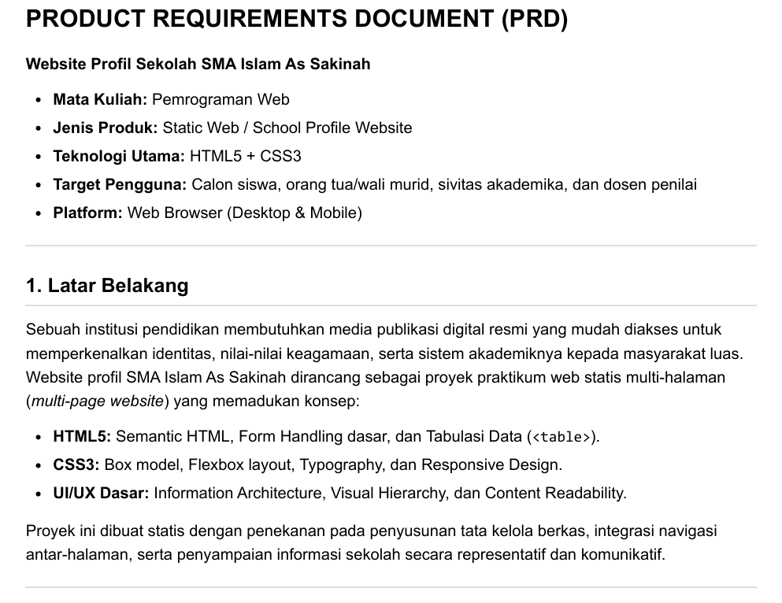

# Week 4 - PRD

Membuat Product Requirements Document berdasarkan situs sekolah yang dibuat sebelumnya, terdiri dari latar belakang, tujuan, struktur (file maupun kode) dan fungsi-fungsi/kebutuhan untuk situs tersebut.

Hasil: [PRD.pdf](./PRD.pdf)