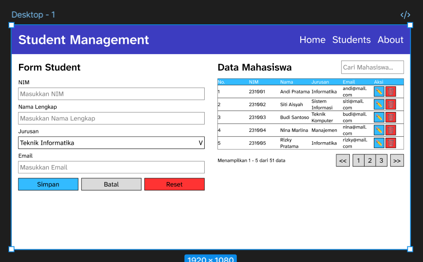
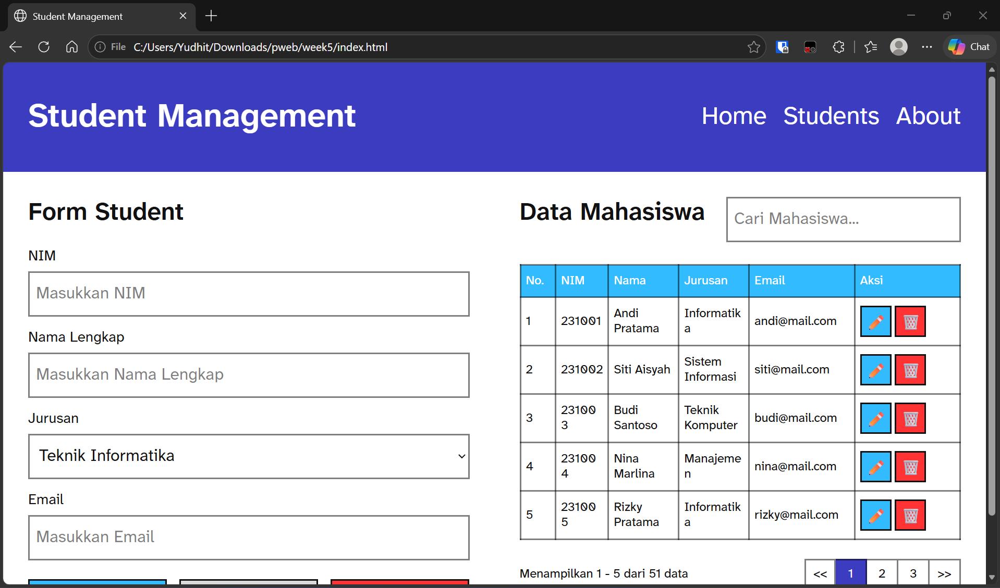

# Week 5 - Latihan CSS (Student Management)

Latihan menggunakan CSS untuk membuat halaman manajemen siswa, berisi tabel-tabel dan form penambahan anggota.

Desain: https://www.figma.com/design/U4htvUkZtjLqFLy52ba8fM/Week-5?node-id=1-2&t=1UqurhgzjwyYyrLE-1

Untuk mengfokuskan CSS, hasil website dimiripkan dengan rakitan desain, dan interaktivitas (termasuk lewat JavaScript) tidak diimplementasi. Form dan tabel masing-masing dibentuk sebagai `<form>` dan `<table>` HTML standar.

Hasil website: https://pweb-26.vercel.app/week5/
