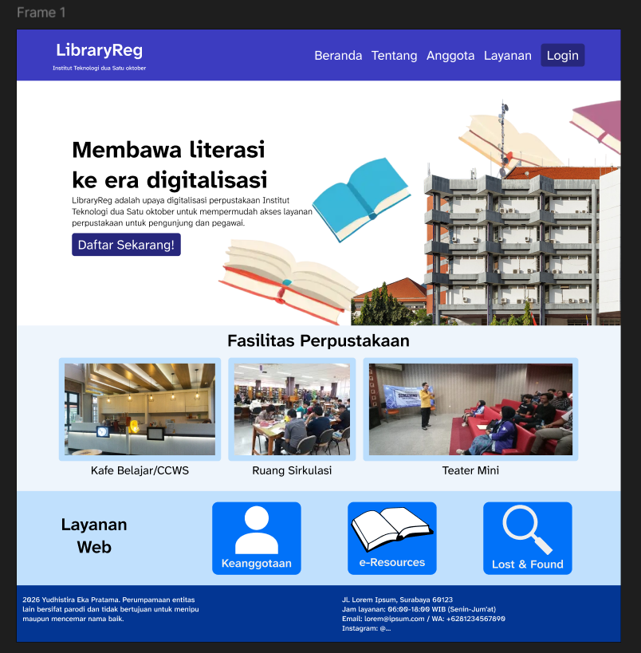
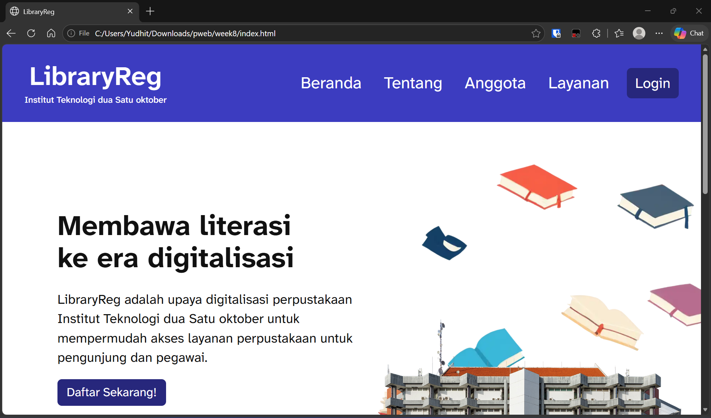
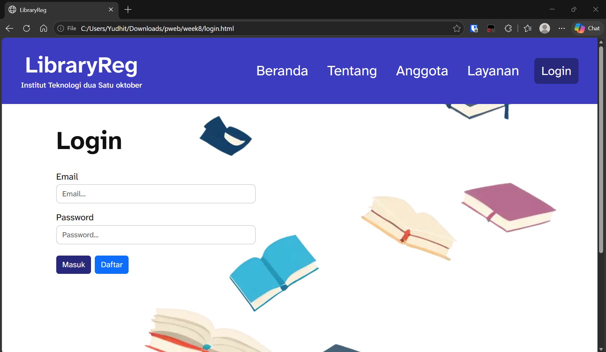
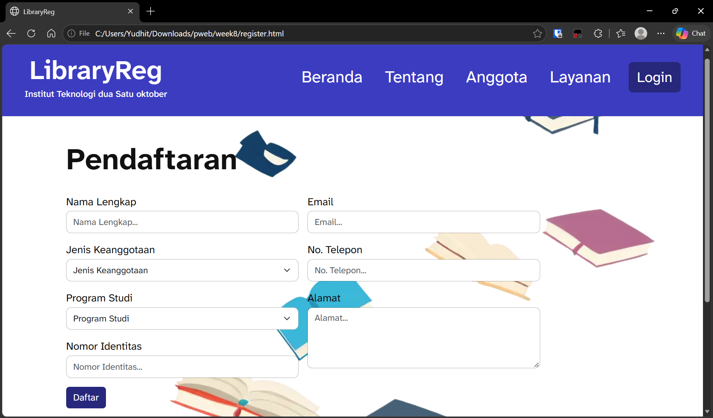
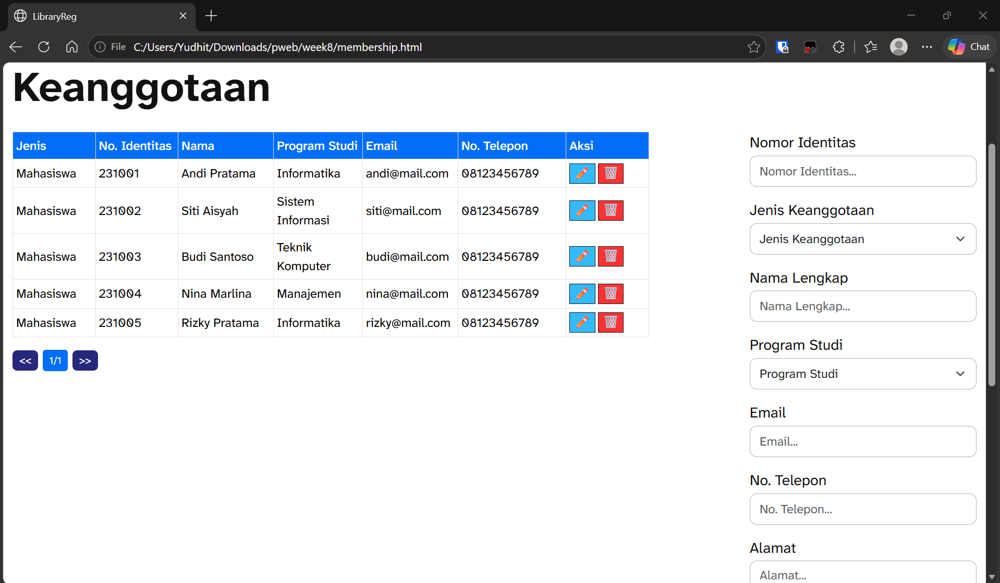

# Evaluasi Tengah Semester - LibraryReg
- Nama: Yudhistira Eka Pratama
- NRP: 5025251136

1. Buat deskripsi dan ruang lingkup pekerjaan yang akan dibuat
- Deskripsi:

Institut Teknologi dua Satu oktober masih melakukan pendaftaran anggota secara manual menggunakan formulir kertas. Proses tersebut menimbulkan beberapa kendala, seperti antrean pendaftaran, kesalahan pencatatan data, kesulitan mencari informasi anggota, dan lambatnya pembuatan kartu anggota.

LibraryReg bertujuan untuk mengkonsolidasi layanan-layanan daring yang dipakai para anggota dan pengunjung serta keberadaan/informasi tentang perpustakaan. Utamanya, LibraryReg menyediakan landing page yang ditujukan untuk masyarakat umum dan anggota/pengunjung. Landing page tersebut berisi informasi tentang fasilitas-fasilitas serta lokasi/kontak perpustakaan. Landing page juga berisi link ke layanan-layanan terpisah seperti Lost & Found dan e-Resources.

Anggota dapat melakukan log in, dan civitas akademika dapat melakukan registrasi untuk menjadi anggota dengan mengisi identitasnya. Data anggota dapat ditambah, dikelola, maupun dihapus pada halaman keanggotaan.
- Ruang lingkup:
  - Landing page dengan navbar, hero, informasi fasilitas & layanan, dan footer.
  - Halaman login & registrasi menjadi anggota
  - Halaman 
2. Buatkan Rancangan Halaman dan Structure Menu:
Beranda:
- Header: Tulisan LibraryReg serta navbar menu:
  - Beranda
  - Tentang
  - Anggota
  - Layanan
  - Tombol Login
- Hero section: Tagline, deskripsi, dan tombol daftar.
- Fasilitas perpustakaan (nama dan gambar)
- Layanan web perpustakaan (tombol-tombol)
- Footer: copyright/disclaimer, alamat, jam layanan, dan kontak
Login:
- Header/navbar
- Formulir email/password
- Footbar
Registrasi anggota:
- Header/navbar
- Formulir pendaftaran:
  - Nama Lengkap
  - Jenis Keanggotaan
  - Program Studi
  - Nomor identitas
  - Email
  - No. Telepon
  - Alamat
- Footer
Keanggotaan:
- Header/navbar
- Tabel anggota
- Formulir penambahan/perubahan data anggota
- Footer
3. Desain UI Landing Page: https://www.figma.com/design/4oY5ViJNqLkjHqvTaTPQoI/Untitled?node-id=0-1&t=OjzGneRc5FnoGmvq-1

4. Implementasikan dan publish web yang dibuat: https://pweb-26.vercel.app/week8/

